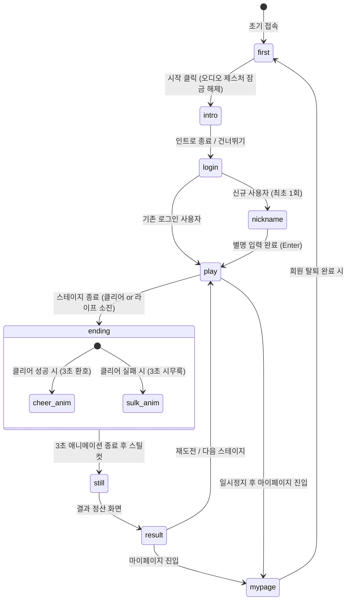
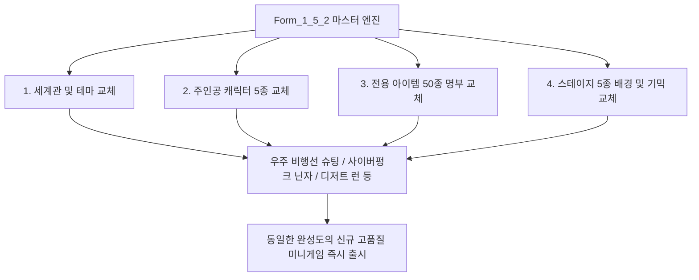

# **미니게임 표준 기획서 (Form_1_5_2)**

_Universal Mini-Game Master Specification & Production Blueprint_  
_기본 참조 프로젝트: 범고래 (Killer Whale) — 횡스크롤 해양 아케이드_

---

# **0. 마스터 양식 개요 및 작성 규칙**

본 문서는 미니게임의 기획, 디자인, 다국어 UX, 3D 그래픽 에셋, 사용자 계정 보안 및 생명주기, 관리자 디버그 툴, 클라우드 배포(GitHub/Firebase/Vercel)까지 완결된 전 과정을 규정하는 **최상위 표준 기획서(Form_1_5_2)**이다.  
본 표준 기획서는 **스토리(세계관/테마), 캐릭터 5종, 아이템 50종, 스테이지 5종의 데이터만 교체하면 누구나 동일한 완성도와 안정성을 가진 상업용 풀스택 미니게임을 즉시 개발**할 수 있도록 설계된 범용 마스터 템플릿이다.

- **절대 코딩 원칙**: 게임 엔진 및 백엔드 등 모든 프로그램 소스 코드와 주석, 변수명, 내부 키는 **100% 영어(English Only)**로 작성한다.
- **다국어 UX 원칙**: 플레이어에게 노출되는 모든 UI 텍스트(메뉴, 메시지, 설명, 에러 등)는 한국어(`ko`), 영어(`en`), 일본어(`ja`) 3개국어를 독립된 언어 사전 폴더/모듈로 완벽히 분리 운영한다.
- **3D 비주얼 표준**: 게임 내 등장하는 모든 캐릭터, 아이템, 장애물은 **배경 없음(Transparent Alpha), 테두리 없음(No Border/Outline), 그림자 없음(No Drop Shadow)**의 고품질 3D 렌더링 에셋으로 제작하며 역동적인 애니메이션 동작을 탑재한다.
- **표준 해상도 & 반응형**: 모바일 가로(1280×720, 16:9~20:9 Safe Area)를 최우선 기준으로 하며, 모바일 세로(720×1280) 및 데스크톱(1600×900)에 완벽 반응형으로 대응한다.
- **모듈형 데이터베이스**: 캐릭터 5종, 전용 수집 아이템 50종, 스테이지 5개, 6초 인트로 동영상, 3초 엔딩(성공 환호/실패 시무룩) 애니메이션을 표준 규격으로 통일한다.

---

# **1. 마스터 문서 메타 정보**

| 항목 | 표준 사양 및 규격 | 스토리 변경 시 작성 예시 (범고래) |
| :--- | :--- | :--- |
| **게임명 (Game Title)** | `{현지화 타이틀}` (한/영/일) | 범고래 (Killer Whale / シャチ) |
| **영문 식별자 (ID)** | `kebab-case-game-id` | `killer-whale-game` |
| **문서 양식 버전** | **Form_1_5_2 (v1.5.2)** | Form_1_5_2 |
| **장르 (Genre)** | 횡스크롤 아케이드 / 도지(Dodge) & 컬렉션 | 2D 횡스크롤 해양 아케이드 |
| **타깃 플랫폼** | 모바일 가로 웹/앱 (iOS/Android), 데스크톱 Web | 스마트폰, 태블릿, PC 브라우저 |
| **플레이 타임** | 판당 2~3분 (5개 스테이지 총 300~320초) | 스테이지당 58초~70초 (총 313초) |
| **비주얼 스타일** | Vibrant 3D Arcade (알파 배경, 무테두리, 무그림자) | Vibrant Aquatic 3D Arcade |
| **코드 언어** | **English Only** (JS, CSS, HTML, Config) | English (auth.js, game.js, i18n.js) |
| **지원 UX 언어** | 한국어(`ko` - 기본), 영어(`en`), 일본어(`ja`) | ko, en, ja 실시간 토글 지원 |
| **배포 스택** | Localhost → GitHub → Firebase / Vercel / Netlify | Vercel Edge + Firebase Auth/DB |

---

# **2. 표준 에셋 보관 폴더 구조 및 규격 (Asset Directory Standard)**

프로젝트 루트의 `Assets/` 디렉토리에 규격화된 전용 폴더를 사전에 생성하여 관리하며, 엔진 코드가 파일명을 감지하여 자동 로드한다.

```
📁 Assets/
├── 📁 video/              # 6초 인트로 시네마틱 동영상 (intro_6s.mp4)
├── 📁 title/              # 메인 첫화면 타이틀 키아트 배경 (title_bg.png)
├── 📁 settings/           # 세팅(환경설정) 글래스모피즘 모달 배경 (settings_modal_bg.png)
├── 📁 store/              # 스토어(상점) UI 배경 및 패키지 아이콘 (store_bg.png, packs)
├── 📁 stages/             # 5개 스테이지별 심리스 파라락스 배경 (stage1 ~ stage5)
├── 📁 characters/         # 3D 주인공 캐릭터 5종 (idle, swim, cheer, sulk 스프라이트)
│   ├── 📁 char_1/         # 캐릭터 1 (예: 범고래)
│   ├── 📁 char_2/         # 캐릭터 2 (예: 상어)
│   ├── 📁 char_3/         # 캐릭터 3 (예: 청새치)
│   ├── 📁 char_4/         # 캐릭터 4 (예: 대왕오징어)
│   └── 📁 char_5/         # 캐릭터 5 (예: 메갈로돈)
├── 📁 prey/               # 50종 수집 전용 아이템 (캐릭터별 10종 x 5폴더)
├── 📁 hazards/            # 장애물 및 적 3D 에셋 (바위, 그물, 어뢰, 잠수함 등)
├── 📁 results/            # 결과/정산 화면 빅토리 카드 배경 (result_bg.png)
└── 📁 icons/              # 모바일/데스크톱 런처 앱 아이콘
    ├── app_icon_mobile.png     # 1024x1024 Squircle 모바일 아이콘
    └── app_icon_desktop.png    # 1024x1024 투명 원형 엠블럼 데스크톱 아이콘
```

### 📋 표준 에셋 기술 규격표
1. **인트로 동영상 (`video/intro_6s.mp4`)**:
   - 해상도: 1280×720 (16:9), H.264 + AAC, 길이 정확히 **6.0초**, 30/60fps, 용량 **1.5MB 미만 엄수** (모바일 즉시 재생 및 무버퍼링).
2. **배경 이미지 (`title/`, `stages/`, `store/`, `results/`)**:
   - 해상도: 1920×1080 또는 1280×720, WebP/PNG, 심리스 수평 루프(Horizontal Seamless) 지원.
3. **3D 캐릭터 & 아이템 (`characters/`, `prey/`, `hazards/`)**:
   - 투명 배경 PNG(RGBA 32bit), **배경색 0%, 테두리 없음, 외곽 그림자 없음**, 512×512 또는 256×256 고해상도.
4. **앱 아이콘 (`icons/`)**:
   - 모바일: 1024×1024 둥근 모서리(Squircle).
   - 데스크톱: 1024×1024 원형 메탈릭 엠블럼 (배경 투명).

---

# **3. 3D 비주얼 디자인 및 렌더링 규격**

### **3.1 핵심 3대 렌더링 원칙**
- **원칙 1: No Background (배경 없음)**: 모든 캐릭터, 아이템, 장애물, 보스 스프라이트는 알파 채널(투명도 100%)을 유지하여 배경 그래픽과 이질감 없이 완벽하게 블렌딩된다.
- **원칙 2: No Border / No Outline (테두리 없음)**: 카툰풍의 인위적인 검정색/유색 테두리를 일체 배제하고, 자연스러운 3D 셰이딩(Specular & Diffuse)과 네온 림라이트(Rim Light)로 볼륨감을 표현한다.
- **원칙 3: No Drop Shadow (외부 그림자 없음)**: 스프라이트 자체에 베이크된 인위적인 바닥 그림자나 흐림 그림자를 제거하여, 어떤 수중/공중 배경에서도 붕 뜨지 않고 수중 엔진 라이팅과 실시간 융합되도록 한다.

### **3.2 역동적 3D 애니메이션 (Dynamic Animation)**
- 캐릭터 및 아이템은 정지된 이미지가 아니며, 부드러운 사인파 상하 부유(Floating Bobbing, 0.05~0.08 rad/frame), 지느러미/추진체 굴절(Mesh Deformation/Wiggle), 네온 발광 펄스(Neon Glow Pulse) 효과를 상시 렌더링한다.

---

# **4. 사용자 상태 생명주기 및 로그인/계정 보안 사양**

## **4.1 전체 상태 전이 다이어그램 (State Flow)**


## **4.2 로그인 인터페이스 상세 규격**
- **인터페이스 구조**:
  - 화면 중앙: 4종 로그인 탭 `[ 게스트 ]`, `[ Google ]`, `[ 이메일 ]`, `[ 전화번호 ]`.
  - 우측 상단: 글로벌 언어 선택 토글 `[ KO | EN | JA ]`.
- **4가지 인증 수단 사양**:
  1. **게스트 (Guest Mode)**:
     - Firebase Anonymous Auth 적용 (환경 변수 부재 시 로컬 임시 게스트 모드로 안전 폴백).
     - 닉네임으로 관리되며, **해당 브라우저 게임 세션 종료 시 닉네임과 세션은 자동 소멸**.
     - 차후 이메일, 전화번호, Google 연동 시 기존에 획득한 `uid`와 플레이 기록을 그대로 유지(Account Linking).
  2. **Google 로그인**:
     - Google OAuth 팝업/리다이렉트 원클릭 연동.
  3. **이메일 + 비밀번호**:
     - 이메일 Placeholder: `name@example.com`.
     - 빈 이메일 제출 시 다국어 에러:
       - 한국어: "이메일을 입력하세요"
       - 영어: "Enter an email"
       - 일본어: "メールアドレスを入力してください"
     - 비밀번호: 6~20자의 영문 및 숫자 조합. 기본은 가림(Hidden), '보기(Show)'/'숨김(Hide)' 토글 지원.
     - 형식 오류 시: "영문 또는 숫자로 입력하세요" / "Use letters or numbers" / "英数字で入力してください".
     - 확인 불일치 시: "비밀번호가 일치하지 않습니다" / "Passwords do not match" / "パスワードが一致しません".
  4. **전화번호 + 비밀번호**:
     - 내부 처리: `{e164}@phone.claypop.invalid` 형식의 가상 이메일 기반 인증 (화면에는 일체 노출되지 않음).
     - 기본 국가번호: `+82` (한국어), placeholder `10-1234-5678`.
     - 일본어(`ja`) 선택 시: 기본 `+81`, placeholder `090-1234-5678`.
     - 영어(`en`) 선택 시: 기본 `+1`, placeholder `202-555-0123`.
- **보안 에러 메시지 원칙 (Security Ambiguity)**:
  - 로그인 실패 시 아이디/비밀번호 중 어느 것이 틀렸는지 해커에게 단서를 주지 않는다:
    - 이메일: "이메일 또는 비밀번호를 다시 확인해 주세요"
    - 전화번호: "전화번호 또는 비밀번호를 다시 확인해 주세요"

## **4.3 닉네임(별명) 수립 규칙**
- 모든 사용자는 최초 1회 닉네임을 설정해야 인게임에 진입할 수 있다.
- 길이 제한: 2~12자 (한글, 영문, 숫자).
- 입력 후 `Enter` 키로 즉시 제출 가능.

## **4.4 오디오 제스처 & 30분 무입력 세션 관리**
- **시작 클릭 오디오 제스처**: 브라우저의 Web Audio API 자동 재생 차단(Autoplay Policy)을 해제하기 위해, 타이틀 화면의 첫 '시작(START)' 클릭을 오디오 컨텍스트 활성화 트리거로 삼으며, 직후 6초 인트로 동영상을 재생한다.
- **30분 무입력 자동 로그아웃**:
  - 플레이어가 키보드/마우스/터치 입력 없이 30분 경과 시 보안을 위해 자동 로그아웃 처리한다.
  - **예외 원칙**: `play`(인게임 플레이 중) 및 `ending`(엔딩 연출 중) 상태에서는 플레이 흐름을 끊지 않도록 타임아웃 타이머를 즉시 보류(Pause)한다.

## **4.5 마이페이지(MyPage) & 2단계 회원 탈퇴 사양**
- **구성 요소**: 현재 닉네임 수정 폼, 비밀번호(표시: `********`), 비밀번호 변경 버튼, 회원 탈퇴 영역. (불필요한 이미지 업로드 슬롯은 일체 두지 않음).
- **2단계 회원 탈퇴 프로세스**:
  1. '탈퇴' 버튼 1차 클릭 시 버튼 라벨이 **'탈퇴 확인'**으로 토글 변경된다.
  2. 법적 고지 안내문구 출력:  
     > *"계정과 개인정보가 삭제됩니다. 순위 기록은 이름을 지운 채 남을 수 있습니다."*
  3. '탈퇴 확인' 클릭 시 백엔드 삭제 시퀀스 실행:
     - Firebase Authentication 계정 삭제
     - Firestore `users/{uid}`, `privateProfiles/{uid}` 문서 영구 삭제
     - `sessions/{sessionId}`에서 `uid`와 `nickname` 필드 클리어
  4. 완료 알림: *"탈퇴가 완료되었습니다."* 출력 후 `first`(첫 화면)로 리다이렉트.

---

# **5. 다국어 (i18n) 아키텍처 및 코딩 규칙**

### **5.1 100% 영어 소스 코드 원칙**
- 모든 파일명(`auth.js`, `game.js`, `i18n.js` 등), 변수명, 함수명, 클래스명, 객체 키, 콘솔 로그, 소스 코드 주석은 오직 **영어(English)**로만 작성한다.

### **5.2 3개국어(KO, EN, JA) 분리 운영 구조**
- 다국어 사전은 독립된 언어 모듈(`i18n.js` 또는 `locales/ko.json`, `en.json`, `ja.json`)에 체계적으로 격리하며, 키-값 구조로 동적 치환한다.

```javascript
// i18n Architecture Standard Example
const I18N_DATA = {
    ko: {
        appTitle: "범고래 (Killer Whale)",
        loginTitle: "로그인",
        errEmptyEmail: "이메일을 입력하세요",
        errPasswordMismatch: "비밀번호가 일치하지 않습니다",
        adminPauseToast: "게임이 순간 정지되었습니다. (UX/디자인 검토 모드)",
        cheerMessage: "스테이지 정복 성공!",
        sulkMessage: "작전에 실패했습니다..."
    },
    en: {
        appTitle: "Killer Whale Arcade",
        loginTitle: "Login",
        errEmptyEmail: "Enter an email",
        errPasswordMismatch: "Passwords do not match",
        adminPauseToast: "Game Paused. (UX/Design Inspection Mode)",
        cheerMessage: "Stage Cleared!",
        sulkMessage: "Mission Failed..."
    },
    ja: {
        appTitle: "キラーホエール",
        loginTitle: "ログイン",
        errEmptyEmail: "メールアドレスを入力してください",
        errPasswordMismatch: "パスワードが一致しません",
        adminPauseToast: "ゲームが一時停止しました。（UX/デザイン確認モード）",
        cheerMessage: "ステージクリア成功！",
        sulkMessage: "ミッション失敗..."
    }
};
```

---

# **6. 스테이지 연출 시스템: 3초 엔딩 애니메이션 & 스틸컷**

각 스테이지 완료 또는 라이프 소진 시 즉각 결과 창으로 넘어가지 않고, 감정적 몰입감을 극대화하는 **3초 전용 엔딩 시퀀스**를 필수 재생한다.

| 상황 | 연출 명칭 | 애니메이션 동작 및 FX (3.0초) | 사운드 / BGM | 후속 전이 |
| :--- | :--- | :--- | :--- | :--- |
| **스테이지 클리어** | **환호 엔딩 (Cheering Victory)** | 주인공 캐릭터가 360도 연속 회전 도약, 네온 폭죽 파티클 분출, 화면 상단 황금빛 물보라, 속도감 넘치는 승리 턴 | 승리 팡파레 SFX + 캐릭터 고유 환호음 | 3초 후 스틸컷(Still) → 결과(Result) 창 |
| **미션 실패 (게임오버)**| **시무룩 엔딩 (Sulking Defeat)** | 주인공 캐릭터가 힘을 잃고 꼬리를 축 늘어뜨리며 천천히 침강, 차가운 블루 비네팅 암전, 빗방울 기포 하강 | 단조 침울 SFX + 거품 잦아드는 소리 | 3초 후 스틸컷(Still) → 결과(Result) 창 |

- **스틸컷(Still Cut)**: 3초 애니메이션 종료 순간 가장 극적인 프레임을 0.5초간 블러/정지시켜 여운을 남긴 후 결과 모달을 페이드인한다.

---

# **7. 관리자(Admin) 전용 개발/검토 'Pause/Go' 시스템**

게임 밸런싱, 스테이지별 그래픽 배치, 반응형 UI 검토를 개발 중에 실시간으로 진행할 수 있도록 관리자 전용 디버그 엔진을 탑재한다.

### **7.1 관리자 계정 표준 사양**
- **관리자 계정 ID**: `byki@daum.net`
- **개발 환경 초기 비밀번호**: `123456`
- **보안 검증 원칙**:
  - 클라이언트 소스 코드에 관리자 비밀번호나 권한 플래그를 절대 하드코딩하지 않는다.
  - 백엔드(Firebase) Custom Claims의 `admin === true` 속성 또는 Firestore 보안 `admins` 컬렉션을 통해서만 관리자 자격을 인가한다.

### **7.2 'Pause/Go' 토글링 버튼 사양**
- **버튼 위치**: 인게임 스테이지 화면의 **상단 오른쪽 최외곽 (Top Right Margin 12px)**.
- **상태 토글**:
  - 평상시: `[ ⏸️ Pause ]` 버튼. 클릭 시 게임의 물리 루프, 스크롤, 타이머, 오브젝트 이동을 즉시 **0 프레임 정지**.
  - 일시정지 시: `[ ▶️ Go ]` 버튼으로 전환. 클릭 시 정지되었던 모든 물리 연산이 오차 없이 **즉시 재개**.
- **검토 기능**:
  - `Pause` 상태에서는 현재 화면의 캐릭터 위치, 적 및 장애물 간격, 텍스트 가독성, 버튼 반응성을 자유롭게 마우스/터치로 인스펙션할 수 있다.
- **철저한 일반 사용자 은닉 (Strict Stealth)**:
  - 인가되지 않은 일반 사용자 및 게스트의 화면에는 DOM 구조 및 CSS상 `display: none !important` 처리되어 **절대로 버튼이 노출되지 않는다**.

---

# **8. 5개 스테이지 및 5종 캐릭터/50종 아이템 표준 시트**

## **8.1 5개 스테이지 레벨 디자인**

| 스테이지 | 테마 및 배경 아트 | 패리타임 | 보스전 콘셉트 | 특수 환경 기믹 |
| :--- | :--- | :--- | :--- | :--- |
| **Stage 1: 태평양** | 에메랄드 청랑함, 수면 햇살 (God Rays) | 58초 | 불법 포획 모선 '헤파이토스 호' & 드론 | 정어리 떼 피딩 프렌지 (피버 타임) |
| **Stage 2: 남극** | 서늘한 아이스 블루, 유빙과 오로라 | 60초 | 빙하 속 고대 아이스 크라켄 | 유빙 대붕괴 (낙하하는 빙산 회피) |
| **Stage 3: 열대산호초**| 네온 핑크/바이올렛 산호 미로 | 60초 | 네온 맹독 가시 '쏠배감펭 퀸' | 해저 급류 래프팅 (이동속도 1.8배) |
| **Stage 4: 대서양심해**| 칠흑의 미드나잇 블루, 난파선 잔해 | 65초 | 첨단 스텔스 군용 잠수함 '네모-X' | 자발광 암전 타임 (빛줄기 추적) |
| **Stage 5: 마리아나해구**| 보랏빛 암흑 & 마그마 열수구 | 70초 | 심연의 군주 '용암 레비아탄' (2페이즈)| 심연의 소용돌이 (중앙 흡인력) |

## **8.2 5종 캐릭터 및 50종 수집 전용 아이템 명부**

| 주인공 캐릭터 | 스탯 (속도/부스트/판정/흡입) | 고유 패시브 스킬 | 전용 수집 아이템 10종 (3D 무테두리/무그림자) |
| :--- | :--- | :--- | :--- |
| **1. 범고래 (Orca)** | 속도 3 / 부스트 3 / 판정 3 / 흡입 3 | **초음파 탐지**: 위험 요소 사전 경고 인디케이터 | 물개, 연어, 바다표범, 펭귄, 청어, 가오리, 바다사자, 오징어, 왕바다표범, 정어리 떼 |
| **2. 상어 (Shark)** | 속도 4 / 부스트 4 / 판정 2 / 흡입 2 | **피의 포식**: 연속 포식 시 속도+20% & 콤보 4배 | 참치, 고등어, 바다거북, 정어리, 방어, 꽁치, 삼치, 날치, 게, 쥐치 |
| **3. 청새치 (Marlin)** | 속도 5 / 부스트 5 / 판정 2 / 흡입 1 | **바늘 돌진**: 점프 부스트 시 소형 그물 파괴 | 무늬오징어, 만새기, 날치, 멸치 떼, 삼치, 고등어, 전갱이, 청새치치어, 꽁치, 바다새 |
| **4. 대왕오징어 (Squid)**| 속도 2 / 부스트 2 / 판정 3 / 흡입 5 | **먹물 은신**: 피격 위기 시 자동 먹물/1.5초 무적 | 심해어, 랜턴피시, 심해새우, 갯지렁이, 갑오징어, 명태, 대구, 심해게, 암모나이트, 크릴새우 떼 |
| **5. 메갈로돈 (Megalodon)**| 속도 2 / 부스트 3 / 판정 5 / 흡입 4 | **최상위 장갑**: 소형 바위/어뢰 충돌 시 파괴 돌파| 고대고래, 대형바다거북, 매너티, 바다사자 떼, 대형참치, 대형가오리, 고대상어, 해양파충류, 향고래, 고대다랑어 |

---

# **9. 조작 체계 및 반응형 UI 레이아웃**

- **양손 엄지 최적화 핫스팟 (인체공학 설계)**:
  - **좌측 하단 (Left 8%, Bottom 12%)**: 순간 상승 부스트 `JUMP` 버튼 (직경 68~84dp).
  - **우측 하단 (Right 8%, Bottom 10%)**: 상/하/좌/우 4방향 `D-PAD` 컨트롤러 (130×130dp 모듈).
- **데스크톱 키보드 매핑**:
  - 이동: `W, A, S, D` 또는 방향키 (`↑, ↓, ←, →`)
  - 점프: `Space Bar`
  - 일시정지/메뉴: `Esc` 또는 `P`
  - 관리자 전용 Pause 단축키: `P` 또는 `F8` (인가된 관리자만 작동)
- **Safe Area & 커스텀 UI 조정**:
  - 스마트폰 노치/다이내믹 아일랜드 영역을 피해 캔버스 패딩을 자동 계산.
  - 설정 화면에서 조작 버튼의 X/Y 위치 오프셋, 크기(80%~120%), 투명도(20%~100%) 자유 조절 기능 제공.

---

# **10. 로컬 실행, 소스 관리, 백엔드 및 글로벌 배포 파이프라인**

## **10.1 Step 1: 로컬호스트(localhost) 실행 및 테스트**
별도의 복잡한 빌드 툴 없이도 브라우저에서 즉시 검토할 수 있도록 정적 웹 서버 환경을 제공한다:
```powershell
# Python 내장 서버로 즉시 로컬 실행 (포트 8000)
python -m http.server 8000
# 브라우저 접속: http://localhost:8000
```
또는 Node.js 환경:
```powershell
npx serve .
```

## **10.2 Step 2: GitHub 형상 관리 및 푸시 규칙**
```bash
# Git 초기화 및 커밋
git init
git add .
git commit -m "feat: complete standard mini-game master form 1.5.2 specification"
git branch -M main
git remote add origin https://github.com/{username}/{repository-name}.git
git push -u origin main
```

## **10.3 Step 3: Firebase 백엔드 연동 세팅**
1. **Firebase Console** 프로젝트 생성 및 Web App 추가.
2. `firebase-config.js`에 SDK 키 구성:
```javascript
const firebaseConfig = {
    apiKey: "AIzaSy...",
    authDomain: "your-game.firebaseapp.com",
    projectId: "your-game",
    storageBucket: "your-game.appspot.com",
    messagingSenderId: "...",
    appId: "..."
};
```
3. **Firestore 보안 규칙 (`firestore.rules`) 배포**:
```javascript
rules_version = '2';
service cloud.firestore {
  match /databases/{database}/documents {
    match /users/{userId} {
      allow read, write: if request.auth != null && request.auth.uid == userId;
    }
    match /admins/{adminId} {
      allow read: if request.auth != null;
      allow write: if request.auth != null && request.auth.token.admin == true;
    }
    match /leaderboard/{docId} {
      allow read: if true;
      allow write: if request.auth != null;
    }
  }
}
```

## **10.4 Step 4: Vercel 또는 Netlify 글로벌 원클릭 배포**
- **Vercel 배포 (`vercel.json`)**:
```json
{
  "version": 2,
  "name": "killer-whale-game",
  "builds": [{ "src": "*", "use": "@vercel/static" }],
  "routes": [
    { "src": "/Assets/(.*)", "dest": "/Assets/$1" },
    { "src": "/(.*)", "dest": "/$1" }
  ]
}
```
- GitHub 저장소를 Vercel/Netlify에 연결하면, `main` 브랜치에 `git push`할 때마다 30초 내에 전 세계 엣지 CDN으로 자동 빌드 및 배포 완료.

---

# **11. 범용 미니게임 테마 변경 가이드 (Theme & Story Swap Guide)**

본 Form_1_5_2 기획서에서 **아래의 4가지 데이터 테이블만 변경**하면 다른 장르/테마의 완성형 미니게임으로 100% 즉시 전환된다:



### 🎮 테마 변경 예시 (우주 SF 슈팅으로 변경할 경우)
1. **스토리 & 비주얼**: 해양 → 심우주 (Deep Space).
2. **주인공 캐릭터 5종**: 범고래/상어/청새치 → 전투순양함, 스텔스기, 요격기, 모선, 드레드노트.
3. **아이템 50종**: 물개/연어/참치 → 플라즈마 코어, 티타늄 볼트, 다크매터, 나노봇 등.
4. **스테이지 5종**: 태평양/남극/심해 → 소행성 지대, 우주 정거장, 블랙홀 왜곡장 등.
5. **엔딩 연출**: 3초 승리 워프 도약(환호) / 3초 추진체 폭발 연기(시무룩).
- **결과**: `auth.js`, `i18n.js`, 관리자 Pause/Go, 30분 타이머, Safe Area 조작키, Firebase/Vercel 인프라는 **코드 수정 없이 100% 그대로 재사용**.

---

# **12. 최종 제작 검증 및 완료 기준 (Master Checklist)**

| 검증 번호 | 필수 검증 항목 | 합격 기준 |
| :---: | :--- | :--- |
| **Q1** | **에셋 폴더 구조** | `Assets/` 아래 `video`, `title`, `settings`, `store`, `stages`, `characters`, `icons` 폴더 완비 |
| **Q2** | **3D 비주얼 규격** | 모든 인게임 캐릭터/아이템이 투명 배경(Alpha), 무테두리, 무그림자 3D 스타일로 렌더링 |
| **Q3** | **인증 생명주기** | `first → intro → login → nickname → play → ending → still → result → mypage` 정상 전이 |
| **Q4** | **로그인 4종 및 유효성** | 게스트(종료 시 소멸), Google, 이메일, 전화번호({e164}@phone... 숨김) 및 다국어 에러 메시지 완벽 일치 |
| **Q5** | **엔딩 애니메이션** | 클리어 시 3초 환호 애니메이션, 실패 시 3초 시무룩 애니메이션 후 스틸컷/결과창 전환 |
| **Q6** | **관리자 Pause/Go** | `byki@daum.net` 로그인 시 상단 우측에만 Pause/Go 버튼 노출, 클릭 시 즉시 정지/재개, 일반 유저 완전 은닉 |
| **Q7** | **30분 무입력 타이머** | 30분 무입력 시 자동 로그아웃, 단 인게임 플레이 및 엔딩 중에는 게임이 끊기지 않도록 정지 보류 |
| **Q8** | **2단계 회원 탈퇴** | '탈퇴' → '탈퇴 확인' 토글, 안내문 표시, Auth/users/privateProfiles 삭제 후 첫 화면 복귀 |
| **Q9** | **코딩 및 i18n 원칙** | 모든 소스코드는 영어로만 작성, UI 메시지는 한국어/영어/일본어 폴더/모듈로 완벽 분리 |
| **Q10** | **배포 파이프라인** | `localhost` 즉시 구동 및 GitHub + Firebase + Vercel/Netlify 배포 사전 설정 완료 |

---
**문서 승인 (Sign-off)**:  
- **상태**: 승인 완료 (APPROVED AS UNIVERSAL MASTER SPECIFICATION)  
- **적용 버전**: Form_1_5_2 (v1.5.2 Master)  
